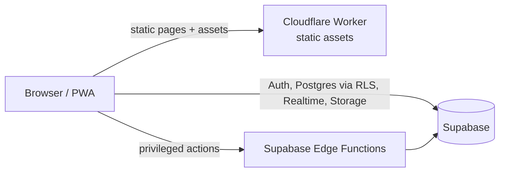
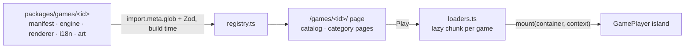
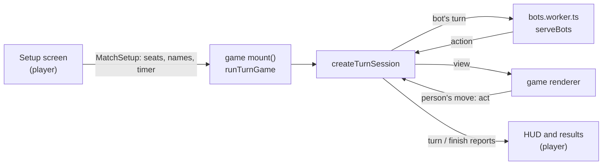
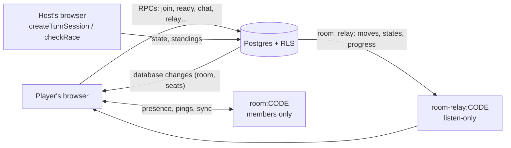
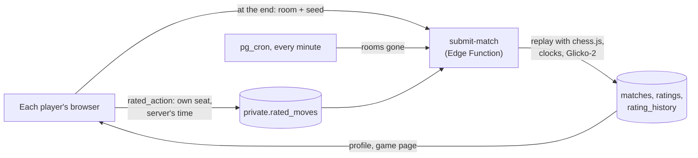
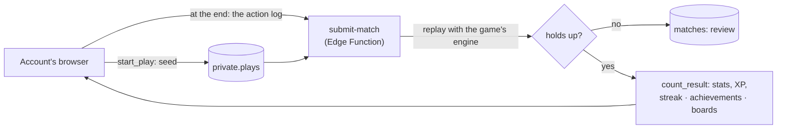
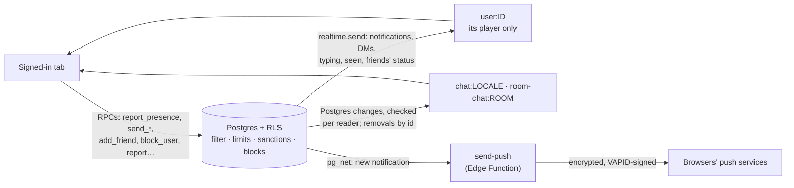

# Architecture

Living overview of how kefche is built. The requirements are in [`SPEC.md`](SPEC.md) and the reasons behind each choice are in [`DECISIONS.md`](DECISIONS.md). Sections marked _(Phase N)_ are written when that phase lands.

## System overview

- **Web app** (`apps/web`): Astro 7 pre-renders every SEO page. React islands add interactivity. A Cloudflare Worker serves the static assets, plus on-demand routes once they exist.
- **Backend:** Supabase. The browser uses only the publishable key, and every table is protected by RLS. Privileged work runs in Edge Functions.

## Workspace

| Package             | Purpose                                                       | Runs in                       |
| ------------------- | ------------------------------------------------------------- | ----------------------------- |
| `apps/web`          | Pages, layouts, islands, features                             | Browser, Worker (build: Node) |
| `@kefche/config`    | tsconfig base, ESLint and Prettier presets                    | Tooling                       |
| `@kefche/ui`        | Design tokens, Tailwind theme, shared primitives              | Browser                       |
| `@kefche/game-sdk`  | Game contracts, engines, PRNG, timers, transport, bot harness | Browser, Worker, Vitest, Deno |
| `@kefche/game-<id>` | One game: engine, bots, renderer, i18n, content               | As above (engine) + browser   |

Isomorphism is enforced by the type system: the base tsconfig has no DOM lib and no ambient `@types`, so engine code can't use browser or Node globals.

## Rendering and routing

- Every route is prefixed by locale: `src/pages/[locale]/…`, generated for all 11 locales.
- **Worker-rendered routes:**
  - `/` (`src/pages/index.ts`) negotiates a locale (cookie `kefche_locale` → `Accept-Language` → `en`) and answers 302 with `Vary: Cookie, Accept-Language` and `no-store`.
  - `404` (`src/pages/404.astro`) renders in the URL's language (`/bg/nope` gives Bulgarian), or negotiates like `/` when the path has no locale, and returns a real 404 status.
- Everything else is static. `public/_headers` sets the security headers for static assets. `src/middleware.ts` parses the same file and applies those headers to every Worker-rendered response, so there's a single source of truth.
- Dev-only pages (`/[locale]/dev/ui/`) return no static paths in production builds, so they're never deployed.
- **Public profiles** (`/[locale]/u/[nickname]/`) are Worker-rendered, so shared links get real titles. They read public columns only, redirect other casings to the canonical nickname, and are noindex.
- **Account pages** (`/auth/*`, `/settings/`, `/profile/`) are static and exist only in builds with Supabase settings (ADR-0011).

## Accounts and data (Phase 2)

- **Sessions** live in the browser (supabase-js, PKCE, `localStorage`). The header shows a cached account summary before paint, and supabase-js loads lazily (ADR-0011).
- **Tables:** `profiles` (public) and `user_settings` (owner-only) (ADR-0012). There are also `user_roles` (with an `app_roles` JWT claim), `consent_records`, an append-only `audit_log`, and in the `private` schema `rate_limits`, `blocked_terms`, `reserved_nicknames` and `deletion_requests`. Every table has RLS.
- **Sign-up and onboarding:** a before-user-created hook and `complete_profile()` enforce 13+ and the nickname rules. Only the birth year is stored, and the month is stripped from auth metadata.
- **Guests** upgrade in place; signing in to another account offers `merge-guest`.
- **Avatars:** 24 presets in `public/avatars/`, plus uploads to the public `avatars` bucket at `<user id>/<uuid>.webp`.
- **Theme and language** sync across devices through `user_settings` (`features/account/preferences-sync.ts`).
- **Data rights:** `export-data` returns a JSON download. Deletion waits 7 days, then `pg_cron` → `pg_net` → `purge-accounts` deletes the account (ADR-0013).

## Game platform (Phase 3)

- **SDK** (`packages/game-sdk`, ADR-0016):
  - The root entry is isomorphic: the engine interfaces (`RaceEngine`, `TurnEngine`, `RealtimeEngine`, `RoundEngine`), the seeded sfc32 `Rng` and `replay()`, plus the manifest types and `defineManifest`.
  - `manifest-schema` holds the Zod schemas, used only at build time.
  - `browser` holds the runtime helpers: the `GameModule` contract, a fixed-step loop, canvas stage, keyboard and swipe input, the stopwatch, haptics, sound (synthesized, ADR-0015) and `runInWorker`.
- **Registry** (`apps/web/src/features/games/registry.ts`): globs every game's manifest, translations and art at build time, validates them, and fails the build on any problem. `loaders.ts` globs each game's `index.ts` lazily, so every game is its own chunk.
- **Pages:**
  - `/[locale]/games/[slug]/` serves both games and categories. A game page has the hero art, Play, how to play and controls, then about, tips and FAQ, with `VideoGame`, `BreadcrumbList` and `FAQPage` JSON-LD.
  - The catalog (`/[locale]/games/`) filters by name with `?q=`, which the header search also uses. Category chips appear only for categories that have games.
- **Player** (`GamePlayer.tsx`): the full-screen island that loads a game on Play and mounts it. It owns the pause menu (Escape, and automatically when the tab is hidden), restart, results, the mute switch and the screen wake lock. It gives the game a seed, its translated `ui` strings, settings and namespaced `localStorage`.
- **Games:**
  - 2048 and Sudoku render with React into the DOM, and Snake with Canvas 2D (ADR-0017). Boards stay left-to-right in Arabic.
  - Sudoku generates and grades puzzles in a Web Worker. Easy and medium need singles only, hard needs locked candidates or subsets, and expert needs X-wing or more.
- **Art:** `pnpm art:generate` draws each game's `assets/art.mjs` emblem with `scripts/game-art/kit.mjs` into `thumbnail.svg` and `hero.svg`, and CI fails on stale art.
- **Adding a game:** `pnpm new:game`, then the checklist in [`ADDING_A_GAME.md`](ADDING_A_GAME.md).

## Turn games, bots and timers (Phase 4)

- **Contracts** (ADR-0018): `TurnEngine`, `Seat` (person or bot), `Bot`, `searchBestAction` (alpha-beta against a deadline, paranoid for 3+ players) and timers as pure state (`createTimers`, `elapse`, `endTurn`, `expiryRule`), all isomorphic.
- **Runtime:** `createTurnSession` decides whose turn it is and asks the game's long-lived bot worker for bot moves, with a budget per difficulty (150/400/900 ms) and at least 400 ms per bot move. It runs the clocks at 100 ms ticks, applies the expiry rule (random move, pass or loss) and pauses with the player, including when the tab is hidden. It offers undo against bots and reports `turn` and `finish` events. `runTurnGame` wraps it as a game's `mount()`.
- **Player:** game pages of kind `turn` offer Play vs bots and Play on this device. The setup screen (`features/games/turn/`) covers players, a person or bot per seat, and the timer, saved per game and mode. The HUD shows seats with colour and shape, whose turn it is, bots thinking and clocks with a low-time warning (red, tick-tock, buzz). Results sit below the board. Setup and HUD are one lazy chunk (2.3 KB gzip) that only turn games load.
- **Games:** Four in a Row (2–4 players, the board grows), Reversi (move hints, clocks) and Dots and Boxes (2–5 players, extra turns). All render with React. Each piece carries its seat's colour and shape, keyboard play uses roving focus, and moves are announced to screen readers.

## Online play (Phase 5)

- **Transport** (ADR-0020): Supabase Realtime Broadcast and Presence on private `room:<code>` channels, with Realtime Authorization. The SDK's `Transport` contract and Zod-checked envelope keep games unaware of Supabase.
- **Authority** (ADR-0021): the host's browser runs the match and sends full states; messages that change a match go through `room_relay`, which checks the sender and stamps `from`. After 5 s without the host, the seated member who joined first takes over.
- **Rooms** (ADR-0022): `rooms` and `room_members`, read through RLS and written only through rate-limited RPCs. A room is deleted as soon as no player is left, with its chat (ADR-0023) and relayed messages; a `pg_cron` sweep every 30 s catches closed pages.
- **Races** (ADR-0024): one seed and the host's options for everyone, a start on the database's clock, live standings, and finishes checked by replaying the moves on the host.
- **Pages:** `/[locale]/play/<game>/?room=CODE` (also `?new`, `?new=public`, `?quick`), the short link `/r/<CODE>`, and the lobby browser at `/[locale]/play/`.

## Chess and rated games (Phase 6)

- **Chess** (ADR-0025): the rules are chess.js as a `TurnEngine`. The board is React DOM. Bots and the analysis view run Stockfish 19 lite in workers, loaded only when needed.
- **Rated results** (ADR-0026): the host runs the live game as in casual play. The server keeps its own record of each player's actions and decides the result by replaying it with chess.js. A record that doesn't replay is stored for review.
- **Ratings** (ADR-0027): Glicko-2 per player, game and pool, updated after every game.
- **Matchmaking:** `rated_search` pairs players on the same clock within ±100, widening to ±400 over 30 s, and gives the pair a private rated room. Both browsers count down to the same moment on the database's clock.
- **Pages:** each finished game has a page, `/[locale]/matches/<id>/`, with its PGN and the analysis, and profiles show ratings and recent games. Both are rendered in the Worker. Reads go through `player_history` and `match_record`, which run as the caller.

### Realtime message budget (SPEC §10.9)

Measured in step 11 on local Supabase with two browsers, counting every websocket frame except heartbeats and replies, per minute for the whole room:

| Room                                 | Messages a minute | What they are                                      |
| ------------------------------------ | ----------------: | -------------------------------------------------- |
| Idle lobby                           |                40 | Latency probes (every 10 s), heartbeat changes     |
| Four in a Row, about 36 moves a min  |               128 | A move and the new state per move, to every member |
| 2048 race, both pressing 3× a second |                84 | Progress only when a score or progress changes     |
| Snake race                           |                24 | Mostly when a snake eats                           |

- Relayed messages reach every member, the sender included, so a room of N players costs about N times as much per message.
- The free plan's 2 million messages a month allow about 260 hours of two-player turn games, or about 830 hours of idle lobbies.

## Stats, XP and leaderboards (Phase 7)

- **The engines on the server** (ADR-0028): `pnpm functions:engines` bundles every game's engine and manifest for Deno (`_shared/engines.gen.js`), so the server replays with the browser's own code.
- **Results** (ADR-0029): an account's game starts on a play the server issued (`start_play`) and ends with its action log sent to `submit-match`. The server replays the log on the play's seed and checks the times and speed. A result that doesn't hold up is stored for review and counts for nothing. Guests' games stay on their device.
- **Counting** (ADR-0030): `private.count_result` updates `player_game_stats`, awards XP (capped per game per day) and the play streak, in SQL, so the scheduled decisions of online matches count the same way. `submit-match` then unlocks achievement tiers from the stats, puts a game played alone on its boards, and answers with the rewards (`match_rewards`) the results screen shows.
- **Leaderboards** (ADR-0031): one row per player, board and period (`all`, `week:<Monday>`, `day:<date>`), filtered when read, with the viewer's own place.
- **The daily challenge:** one seed a day for everyone, rotating through the games played alone. It's made when first asked for, played on its own play, and has its own board.
- **Pages:** the profile shows stats, the rating charts, the level and achievements; `/[locale]/leaderboards/` and each game page show boards; the home page has the daily challenge; settings has the avatar frames. One results screen (`GameResults`) ends every game in every mode.

## Social, chat and moderation (Phase 8)

- **Live connection and status** (ADR-0033): one connection per signed-in tab, on its player's private channel `user:<id>`, which only the database writes. Tabs report what they're doing; the database works out each player's status, tells their friends, and answers `presence_of` for everyone else allowed. A tab hidden for 5 minutes disconnects.
- **Chat** (ADR-0034): global chat and DMs in `public.messages`, lobby and in-game chat in `room_messages`, all written through RPCs. Global and lobby chat arrive as Postgres changes, checked against the read policy for each reader; DMs as broadcasts to the two players' channels.
- **Moderation** (ADR-0035): the word filter, rate limits, slow mode, sanctions, reports (hidden at three accounts) and blocks are enforced in SQL. Staff actions go to `audit_log`. Until the admin panel, the RUNBOOK gives the SQL.
- **Notifications and push** (ADR-0036): rows in `notifications`, worded by the app in the reader's language and sent live on `user:<id>`. A trigger asks `send-push` for the ones a player wants as a push; it words them with the same code (`pnpm functions:push`). Email has preferences and an outbox for Phase 21.
- **Emoji and GIFs** (ADR-0032): a self-hosted Emojibase, and GIPHY through the `giphy` function, behind `PUBLIC_GIFS`.
- **Pages:** `/[locale]/friends/`, `/[locale]/chat/`, `/[locale]/messages/` and `/[locale]/notifications/` (accounts builds, noindex), the community guidelines, the profile's friend actions, the bell, and settings' privacy and notification sections.

### Realtime message budget (Phase 8)

Measured in step 13 on local Supabase: five accounts, A with four friends, each listening as the site does. The counts are messages received. Supabase also bills each broadcast once as sent, and the database broadcasts once per player's channel, so a status change to 4 friends bills 8 and a DM 4. A Postgres change bills only what's received.

| Action                                                           | Received | What they are                                           |
| ---------------------------------------------------------------- | -------: | ------------------------------------------------------- |
| A's status changes (comes online, opens a lobby, closes the tab) |        4 | One per friend                                          |
| A's minute heartbeat, no change                                  |        0 |                                                         |
| An invite, a friend request, any notification                    |        1 | To its player                                           |
| A DM                                                             |        2 | To both players (the first unread one also notifies: 3) |
| Typing, "seen"                                                   |        1 | To the other player                                     |
| Deleting a DM                                                    |        2 | To both players                                         |
| A global chat message, 5 in the room                             |        5 | One per reader, the sender included                     |
| Deleting it                                                      |        5 | One per reader                                          |
| A lobby chat message, 3 in the room                              |        3 | One per reader, the sender included                     |
| Removing a friend                                                |        0 |                                                         |

- **Global chat dominates:** each message costs one per reader. A room of 50 readers with a message every 10 s costs about 18,000 an hour, so 4 such hours a day use about 2.2 million a month, past the free plan's 2 million. Slow mode is the lever; the Pro plan includes 5 million.
- **Everything else is small:** a player with 20 friends online who changes status 10 times an hour bills about 400 an hour, and 100 DMs about 400.
- **Connections, not messages, may bind first:** every open, visible, signed-in tab holds one of the free plan's 200 concurrent connections.

## Internationalization

- **Registry:** `src/i18n/locales.ts` lists every locale with its native name, BCP 47 tag, `dir`, script and OG locale. Routing, fonts, `<html lang dir>`, hreflang and the language switcher all derive from it.
- **Messages:** `apps/web/locales/<locale>/<namespace>.json` (`common`, `nav`, `errors`, `account`, `auth`, `profile`, `settings`), with English as the source. `getT(locale)` returns a cached i18next + ICU instance with **no fallback language**. Keys are always written in full as `"<namespace>:<key>"` and type-checked against the English JSON.
- **Build-time translation:** pages translate during server rendering, and islands receive translated strings as props, so no i18n runtime ships to the browser (ADR-0009).
- **Integrity:** `pnpm i18n:check` (CI) compares every locale with English: namespaces, keys, ICU validity and placeholders. It also fails on unused or undefined keys, found as string literals in the source.
- **Language choice:** the switcher stores an explicit choice in the `kefche_locale` cookie (read by `/` and the 404 page) and in localStorage.
- **RTL:** `dir="rtl"` on `<html>`, with logical properties only. Directional icons mirror with `rtl:-scale-x-100`, and Radix components get `dir` from the page locale. Game boards (Phase 3+) are never mirrored.
- **Fonts:** `components/Fonts.astro` emits only the faces for the page's script. `packages/ui/typography.css` picks the stack with `:lang()` (ADR-0008). The Arabic and Devanagari faces have no fallbacks of their own, so Latin letters and digits on those pages fall through to Inter.

## Styling and theming

- Tokens live in `packages/ui/src/tokens.css` (light on `:root`, dark through the system preference or `[data-theme="dark"]`) and are mapped to Tailwind colors in `packages/ui/src/theme.css` (ADR-0004). `pnpm check:contrast` enforces WCAG ratios for every text/surface pair in both themes, plus the player and category ink-on-fill pairs.
- `components/BootScript.astro` is a tiny inline script that applies the stored theme and side-menu state before first paint (no flash). The theme switcher (`features/theme/ThemeSwitcher.astro`) is a static radio group: its highlight follows `<html data-theme>` in CSS, and `theme.client.ts` saves the choice and keeps every switcher and open tab in sync.
- Components live in `packages/ui/src/components` (ADR-0010). Static ones render to plain HTML; dialog, sheet, tabs and toast need a client island.

## App shell

`src/features/shell/AppShell.astro` wraps every page:

| Width        | Navigation                              | Search, theme and language   |
| ------------ | --------------------------------------- | ---------------------------- |
| < 768 px     | Bottom tab bar                          | Settings panel (gear button) |
| 768–1023 px  | Header links                            | Settings panel               |
| 1024–1279 px | Header links                            | Inline in the header         |
| ≥ 1280 px    | Collapsible side menu (state persisted) | Inline in the header         |

- Nav items come from `src/features/shell/nav.ts`. Items marked `soon` link to a localized, `noindex` coming-soon page (`src/pages/[locale]/[section].astro`). Each phase that ships a section flips its item to `available` and adds the real page.
- `shell.client.ts` (no framework) handles `
` (Escape, outside click), remembering the language choice, and the side-menu toggle.
- Every page has a skip link, landmarks, `aria-current` on the active section, safe-area insets on all edges, and touch targets of at least 44 px.

## Brand assets

The marks' geometry lives once in `packages/ui/src/brand/marks.ts`. `components/Logo.astro` renders it with theme tokens, and `pnpm icons:generate` (sharp) rebuilds `favicon.svg`, `favicon.ico`, the Apple touch icon and the 192/512/maskable app icons in `apps/web/public/`.

## Performance baseline (Phase 1)

Measured on the production build:

- JS on content pages is about 4 KB gzip (budget 120 KB). It was 74 KB while the theme switcher was a React island; Phase 2 made it static, so content pages load no React.
- The home page HTML is about 8 KB gzip.
- Lighthouse mobile scored accessibility 100, best practices 100 and SEO 100 on the home pages. Performance was 82–92 against the uncompressed local preview. Phase 18 owns the final tuning.

## Game pages (Phase 3)

Measured on the production build:

- **JavaScript:** a game page loads 96 KB gzip before Play: React, the player and the shell. Play adds the game's own chunk: 2048 3.8 KB, Snake 5.6 KB, and Sudoku 9.7 KB including its worker.
- **Lighthouse mobile** (production): accessibility, best practices and SEO 100, CLS 0 and TBT 0 ms on every game page and the catalog. Performance is 85–99 between runs, and LCP 2.0–3.3 s on English pages. Arabic pages are slower (LCP about 4 s) because they preload a 277 KB Arabic font.
- **Phase 4:** game pages load 100 KB before Play; the player gained the setup and result logic. A turn match adds 8–9 KB (the game, the turn runtime and the setup/HUD chunk) plus a 2.3 KB bot worker. On a 4× slowed CPU, hard bots answered in 0.90–0.93 s; Four in a Row had one 75 ms main-thread task, and the other two games had none.

## Configuration and environment

Public variables (`PUBLIC_*`) are validated with Zod in `apps/web/src/lib/env.ts` and documented in `apps/web/.env.example`. Secrets never reach client code.

## Delivery pipeline

GitHub Actions `CI` runs format check → lint → contrast → translations → typecheck → build on PRs and on `main`, then deploys with Wrangler: production on `main`, and a per-PR preview alias for each PR. See [`RUNBOOK.md`](RUNBOOK.md).

## Sections to come

- Realtime message budget for real-time arenas (SPEC §10.9) _(Phase 9)_
- PWA install, audio and haptics _(Phase 16; no offline mode, ADR-0014)_
- Consent, analytics and monitoring _(Phase 17)_
