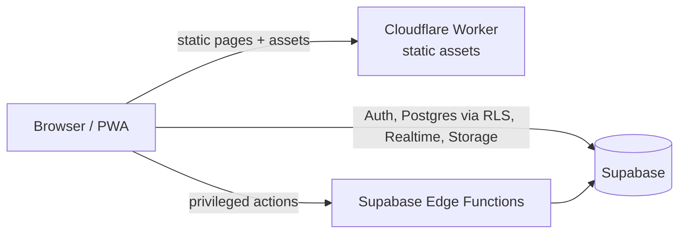

# Architecture

Living overview of how kefche is built. The requirements are in [`SPEC.md`](SPEC.md) and the reasons behind each choice are in [`DECISIONS.md`](DECISIONS.md). Sections marked _(Phase N)_ are written when that phase lands.

## System overview

- **Web app** (`apps/web`): Astro 7 pre-renders every SEO page. React islands add interactivity. A Cloudflare Worker serves the static assets, plus on-demand routes once they exist.
- **Backend:** Supabase. The browser uses only the publishable key, and every table is protected by RLS. Privileged work runs in Edge Functions.

## Workspace

| Package             | Purpose                                                       | Runs in                       |
| ------------------- | ------------------------------------------------------------- | ----------------------------- |
| `apps/web`          | Pages, layouts, islands, features                             | Browser, Worker (build: Node) |
| `@kefche/config`    | tsconfig base, ESLint and Prettier presets                    | Tooling                       |
| `@kefche/ui`        | Design tokens, Tailwind theme, shared primitives              | Browser                       |
| `@kefche/game-sdk`  | Game contracts, engines, PRNG, timers, transport, bot harness | Browser, Worker, Vitest, Deno |
| `@kefche/game-<id>` | One game: engine, bots, renderer, i18n, content               | As above (engine) + browser   |

Isomorphism is enforced by the type system: the base tsconfig has no DOM lib and no ambient `@types`, so engine code can't use browser or Node globals.

## Rendering and routing

- Every route is prefixed by locale: `src/pages/[locale]/…`. Phase 0 ships only `en`, and `/` redirects to `/en/` with a 302 (TODO #1).
- Static by default. On-demand routes (public profile, room invite) arrive in later phases and must set security headers in middleware, because `_headers` applies to static assets only.

## Styling and theming

Tokens live in `packages/ui/src/tokens.css` (light on `:root`, dark through the system preference or `[data-theme="dark"]`) and are mapped to Tailwind colors in `packages/ui/src/theme.css`. See ADR-0004.

## Configuration and environment

Public variables (`PUBLIC_*`) are validated with Zod in `apps/web/src/lib/env.ts` and documented in `apps/web/.env.example`. Secrets never reach client code.

## Delivery pipeline

GitHub Actions `CI` runs format check → lint → typecheck → build on PRs and on `main`, then deploys with Wrangler: production on `main`, and a per-PR preview alias for each PR. See [`RUNBOOK.md`](RUNBOOK.md).

## Sections to come

- Internationalization: routing, detection, namespaces, RTL _(Phase 1)_
- Data model and RLS overview _(Phase 2)_
- Game platform: registry, engine kinds, bots in workers _(Phase 3–4)_
- Multiplayer: transport, rooms, host authority, migration, reconnection _(Phase 5)_
- Realtime message budget per game kind (SPEC §10.9) _(Phase 5, 9)_
- Stats, ratings and result integrity _(Phase 6–7)_
- Social, chat and moderation _(Phase 8)_
- PWA and offline _(Phase 16)_
- Consent, analytics and monitoring _(Phase 17)_
