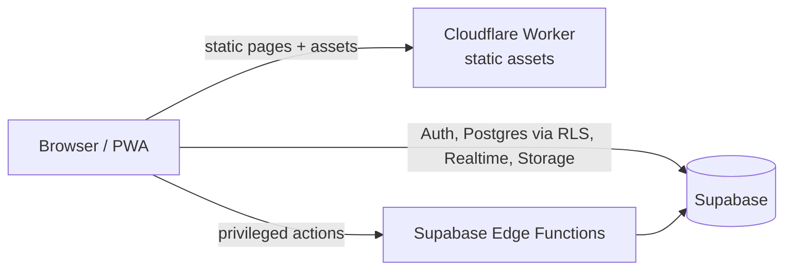

# Architecture

Living overview of how kefche is built. The requirements are in [`SPEC.md`](SPEC.md) and the reasons behind each choice are in [`DECISIONS.md`](DECISIONS.md). Sections marked _(Phase N)_ are written when that phase lands.

## System overview

- **Web app** (`apps/web`): Astro 7 pre-renders every SEO page. React islands add interactivity. A Cloudflare Worker serves the static assets, plus on-demand routes once they exist.
- **Backend:** Supabase. The browser uses only the publishable key, and every table is protected by RLS. Privileged work runs in Edge Functions.

## Workspace

| Package             | Purpose                                                       | Runs in                       |
| ------------------- | ------------------------------------------------------------- | ----------------------------- |
| `apps/web`          | Pages, layouts, islands, features                             | Browser, Worker (build: Node) |
| `@kefche/config`    | tsconfig base, ESLint and Prettier presets                    | Tooling                       |
| `@kefche/ui`        | Design tokens, Tailwind theme, shared primitives              | Browser                       |
| `@kefche/game-sdk`  | Game contracts, engines, PRNG, timers, transport, bot harness | Browser, Worker, Vitest, Deno |
| `@kefche/game-<id>` | One game: engine, bots, renderer, i18n, content               | As above (engine) + browser   |

Isomorphism is enforced by the type system: the base tsconfig has no DOM lib and no ambient `@types`, so engine code can't use browser or Node globals.

## Rendering and routing

- Every route is prefixed by locale: `src/pages/[locale]/…`, generated for all 11 locales.
- **Worker-rendered routes:**
  - `/` (`src/pages/index.ts`) negotiates a locale (cookie `kefche_locale` → `Accept-Language` → `en`) and answers 302 with `Vary: Cookie, Accept-Language` and `no-store`.
  - `404` (`src/pages/404.astro`) renders in the URL's language (`/bg/nope` gives Bulgarian), or negotiates like `/` when the path has no locale, and returns a real 404 status.
- Everything else is static. `public/_headers` sets the security headers for static assets. `src/middleware.ts` parses the same file and applies those headers to every Worker-rendered response, so there's a single source of truth.
- Dev-only pages (`/[locale]/dev/ui/`) return no static paths in production builds, so they're never deployed.

## Internationalization

- **Registry:** `src/i18n/locales.ts` lists every locale with its native name, BCP 47 tag, `dir`, script and OG locale. Routing, fonts, `<html lang dir>`, hreflang and the language switcher all derive from it.
- **Messages:** `apps/web/locales/<locale>/<namespace>.json` (`common`, `nav`, `errors`), with English as the source. `getT(locale)` returns a cached i18next + ICU instance with **no fallback language**. Keys are always written in full as `"<namespace>:<key>"` and type-checked against the English JSON.
- **Build-time translation:** pages translate during server rendering, and islands receive translated strings as props, so no i18n runtime ships to the browser (ADR-0009).
- **Integrity:** `pnpm i18n:check` (CI) compares every locale with English: namespaces, keys, ICU validity and placeholders. It also fails on unused or undefined keys, found as string literals in the source.
- **Language choice:** the switcher stores an explicit choice in the `kefche_locale` cookie (read by `/` and the 404 page) and in localStorage.
- **RTL:** `dir="rtl"` on `<html>`, with logical properties only. Directional icons mirror with `rtl:-scale-x-100`, and Radix components get `dir` from the page locale. Game boards (Phase 3+) are never mirrored.
- **Fonts:** `components/Fonts.astro` emits only the faces for the page's script. `packages/ui/typography.css` picks the stack with `:lang()` (ADR-0008).

## Styling and theming

- Tokens live in `packages/ui/src/tokens.css` (light on `:root`, dark through the system preference or `[data-theme="dark"]`) and are mapped to Tailwind colors in `packages/ui/src/theme.css` (ADR-0004). `pnpm check:contrast` enforces WCAG ratios for every text/surface pair in both themes, plus the player and category ink-on-fill pairs.
- `components/BootScript.astro` is a tiny inline script that applies the stored theme and side-menu state before first paint (no flash). The theme switcher shares a Zustand store across islands and tabs.
- Components live in `packages/ui/src/components` (ADR-0010). Static ones render to plain HTML; dialog, sheet, tabs and toast need a client island.

## App shell

`src/features/shell/AppShell.astro` wraps every page:

| Width        | Navigation                              | Search, theme and language   |
| ------------ | --------------------------------------- | ---------------------------- |
| < 768 px     | Bottom tab bar                          | Settings panel (gear button) |
| 768–1023 px  | Header links                            | Settings panel               |
| 1024–1279 px | Header links                            | Inline in the header         |
| ≥ 1280 px    | Collapsible side menu (state persisted) | Inline in the header         |

- Nav items come from `src/features/shell/nav.ts`. Items marked `soon` link to a localized, `noindex` coming-soon page (`src/pages/[locale]/[section].astro`). Each phase that ships a section flips its item to `available` and adds the real page.
- `shell.client.ts` (no framework) handles `
` (Escape, outside click), remembering the language choice, and the side-menu toggle.
- Every page has a skip link, landmarks, `aria-current` on the active section, safe-area insets on all edges, and touch targets of at least 44 px.

## Brand assets

The marks' geometry lives once in `packages/ui/src/brand/marks.ts`. `components/Logo.astro` renders it with theme tokens, and `pnpm icons:generate` (sharp) rebuilds `favicon.svg`, `favicon.ico`, the Apple touch icon and the 192/512/maskable app icons in `apps/web/public/`.

## Performance baseline (Phase 1)

Measured on the production build:

- JS on content pages is 74 KB gzip (budget 120 KB). About 63 KB of that is React DOM for the theme-switcher island.
- The home page HTML is about 8 KB gzip.
- Lighthouse mobile scored accessibility 100, best practices 100 and SEO 100 on the home pages. Performance was 82–92 against the uncompressed local preview. Phase 18 owns the final tuning.

## Configuration and environment

Public variables (`PUBLIC_*`) are validated with Zod in `apps/web/src/lib/env.ts` and documented in `apps/web/.env.example`. Secrets never reach client code.

## Delivery pipeline

GitHub Actions `CI` runs format check → lint → contrast → translations → typecheck → build on PRs and on `main`, then deploys with Wrangler: production on `main`, and a per-PR preview alias for each PR. See [`RUNBOOK.md`](RUNBOOK.md).

## Sections to come

- Data model and RLS overview _(Phase 2)_
- Game platform: registry, engine kinds, bots in workers _(Phase 3–4)_
- Multiplayer: transport, rooms, host authority, migration, reconnection _(Phase 5)_
- Realtime message budget per game kind (SPEC §10.9) _(Phase 5, 9)_
- Stats, ratings and result integrity _(Phase 6–7)_
- Social, chat and moderation _(Phase 8)_
- PWA and offline _(Phase 16)_
- Consent, analytics and monitoring _(Phase 17)_
